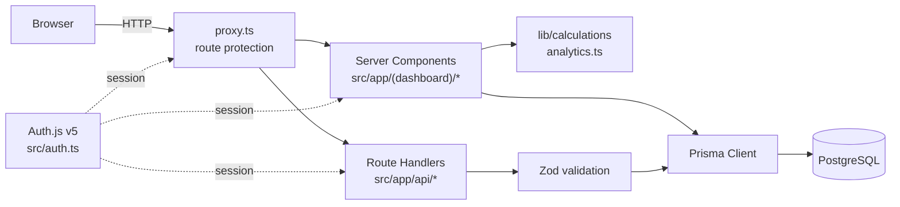
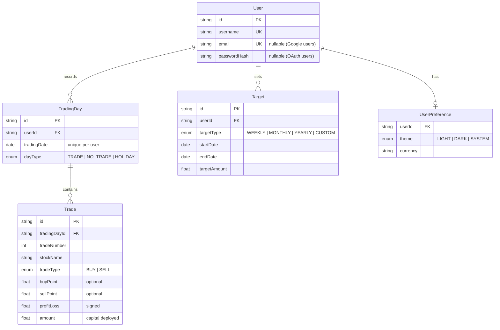

<div align="center">

# 📈 On-Track

**A personal intraday trading journal and P&L analytics dashboard.**

Record each trading day, classify it as **Trade / No Trade / Holiday**, and see your profit and loss for today, this week, month, year and overall.

[](https://github.com/sanju-221/Vibe_code/actions/workflows/ci.yml)


[](LICENSE)

</div>

---

## Table of contents

- [Features](#features)
- [Tech stack](#tech-stack)
- [Architecture](#architecture)
- [Project structure](#project-structure)
- [Getting started](#getting-started)
- [Environment variables](#environment-variables)
- [Available scripts](#available-scripts)
- [Data model](#data-model)
- [API reference](#api-reference)
- [Design decisions](#design-decisions)
- [Deployment](#deployment)
- [Continuous integration](#continuous-integration)
- [Roadmap](#roadmap)
- [License](#license)

---

## Features

### 🏠 Dashboard
- **Today's status card**: greeting, today's net P/L, and **Profit** / **Loss** buttons that expand to show the winning or losing trades.
- **KPI cards**: net P/L for today, this week, this month, this year and overall, plus total trades, win rate and average trade.
- **P&L breakdown**: gross profit, gross loss and net P/L per period (Today / Week / Month / Year / Overall), with a profit-factor badge.
- **Charts**: monthly P/L bars and a win/loss donut.
- **Recent trading days**, with No Trade ☕ and Holiday 🏖️ days highlighted.
- **Target progress** for active targets.

### ✍️ Trade entry
A guided 3-step flow:
1. **Date**: pick from a calendar (future dates disabled).
2. **Day type**: **Trade**, **No Trade** or **Holiday**. No Trade and Holiday save instantly.
3. **Trades**: choose how many, then fill in stock, BUY/SELL, buy/sell points, a **Profit/Loss** toggle with an amount, and the capital deployed.

Picking a date that already exists **adds** the new trades to that day instead of failing.

### 📜 Trade history
- Paginated list of every recorded day, with type badges.
- Expand a day to **edit**, **delete** or **add** trades inline.
- Delete a whole day (with confirmation).
- Day detail page with per-day stats (best/worst trade, average win, amount traded…).

### 📊 Analysis
Period selector, a 12-metric KPI grid, cumulative P/L curve, P/L by stock, and BUY vs SELL performance.

### 🎯 Targets
Weekly, monthly, yearly or custom-range profit targets with circular progress indicators.

### ⚙️ Settings and auth
- Username/password sign-in and sign-up, plus optional **Sign in with Google**.
- Light / Dark / System theme.
- Password change.

---

## Tech stack

| Layer | Technology |
|---|---|
| Framework | [Next.js 16](https://nextjs.org) (App Router, Turbopack, React Server Components) |
| UI | React 19, Tailwind CSS v4, Radix UI primitives, lucide-react icons |
| Charts | Recharts |
| Dates | date-fns, react-day-picker |
| Auth | [Auth.js v5](https://authjs.dev) (JWT sessions): Credentials + Google |
| Database | PostgreSQL + [Prisma ORM 6](https://www.prisma.io) |
| Validation | Zod |
| Notifications | Sonner |
| Tooling | TypeScript (strict), ESLint 9 (`eslint-config-next`), GitHub Actions |

---

## Architecture



- **Reads** happen in Server Components that query Prisma directly. There is no client-side data fetching for page loads.
- **Writes** go through REST-style Route Handlers under `src/app/api`. Each one checks the session, validates the body with Zod, and verifies ownership.
- **Route protection** is handled by `src/proxy.ts`, the Next.js 16 replacement for `middleware.ts`. Unauthenticated users are redirected to `/login`.

---

## Project structure

```text
on-track/
├── .github/
│   └── workflows/ci.yml          # Lint → typecheck → build on every push / PR
├── prisma/
│   ├── schema.prisma             # Database schema
│   └── seed.ts                   # Seeds an initial admin user
├── public/                       # Static assets
├── src/
│   ├── app/
│   │   ├── (dashboard)/          # Authenticated app shell (sidebar layout)
│   │   │   ├── dashboard/        # Home dashboard
│   │   │   ├── trades/           # History, /new entry flow, /[date] detail
│   │   │   ├── analysis/         # Analytics
│   │   │   ├── targets/          # Profit targets
│   │   │   └── settings/         # Theme & password
│   │   ├── api/                  # Route handlers (REST)
│   │   │   ├── auth/             # Auth.js + registration
│   │   │   ├── trading-days/     # Day CRUD (+ /[date])
│   │   │   ├── trades/           # Trade CRUD (+ /[id])
│   │   │   ├── targets/          # Target CRUD (+ /[id])
│   │   │   └── settings/         # Password change
│   │   ├── login/                # Sign in / sign up
│   │   ├── layout.tsx            # Root layout, theme provider, toaster
│   │   └── globals.css           # Tailwind v4 theme tokens
│   ├── components/
│   │   ├── analysis/  charts/  dashboard/  layout/
│   │   ├── providers/ settings/ targets/   trades/   ui/
│   ├── lib/
│   │   ├── calculations/analytics.ts   # All P&L / win-rate maths (pure functions)
│   │   ├── db/prisma.ts                # Prisma client singleton
│   │   ├── utils/date-boundaries.ts    # UTC-safe period boundaries
│   │   └── utils.ts                    # cn() and helpers
│   ├── auth.ts                   # Auth.js configuration
│   └── proxy.ts                  # Route protection
├── .env.example                  # Environment template (copy to .env)
├── next.config.ts
├── tsconfig.json                 # `@/*` → `src/*`
└── package.json
```

---

## Getting started

### Prerequisites

- **Node.js ≥ 20.9** (see `.nvmrc`)
- **PostgreSQL 14+** running locally, or a hosted database (Neon, Supabase, RDS…)

### 1. Clone and install

```bash
git clone https://github.com/sanju-221/Vibe_code.git
cd Vibe_code
npm install          # also generates the Prisma client
```

### 2. Configure the environment

```bash
cp .env.example .env
```

Fill in `DATABASE_URL` and generate an `AUTH_SECRET`:

```bash
openssl rand -base64 32
```

> Prisma CLI reads `.env`. Next.js reads both `.env` and `.env.local`. One `.env` file is enough.

### 3. Create the database schema

```bash
createdb ontrack     # or create it in pgAdmin
npm run db:push
```

### 4. (Optional) Seed an admin user

```bash
npm run db:seed
```

This creates the user **`admin` / `admin123`**. **Change the password right away** under *Settings*, or simply register a new account on the login page.

### 5. Run

```bash
npm run dev
```

Open <http://localhost:3000>.

---

## Environment variables

| Variable | Required | Description |
|---|:---:|---|
| `DATABASE_URL` | ✅ | PostgreSQL connection string |
| `AUTH_SECRET` | ✅ | Secret used to sign session JWTs (`openssl rand -base64 32`) |
| `NEXTAUTH_URL` | ✅ | Public base URL, e.g. `http://localhost:3000` |
| `GOOGLE_CLIENT_ID` | ➖ | Google OAuth client ID (enables "Continue with Google") |
| `GOOGLE_CLIENT_SECRET` | ➖ | Google OAuth client secret |

For Google sign-in, add the redirect URI `http://localhost:3000/api/auth/callback/google` (and your production equivalent) in Google Cloud Console.

> [!CAUTION]
> Never commit `.env` or `.env.local`. They are git-ignored; only `.env.example` is tracked.

---

## Available scripts

| Script | Description |
|---|---|
| `npm run dev` | Start the dev server (Turbopack) |
| `npm run build` | Production build |
| `npm run start` | Serve the production build |
| `npm run lint` | ESLint |
| `npm run typecheck` | TypeScript, no emit |
| `npm run db:generate` | Regenerate the Prisma client |
| `npm run db:push` | Sync `schema.prisma` to the database |
| `npm run db:seed` | Seed the admin user |
| `npm run db:studio` | Open Prisma Studio |

> [!IMPORTANT]
> After changing `schema.prisma`, **stop the dev server**, then run `npm run db:push`. On Windows the running server locks the Prisma engine file, so the client can't be regenerated while it runs.

---

## Data model



---

## API reference

Every endpoint needs an authenticated session and only touches the caller's own data.

| Method | Endpoint | Description |
|---|---|---|
| `POST` | `/api/auth/register` | Create a username/password account |
| `GET` | `/api/trading-days?page=&limit=` | Paginated trading days with trades |
| `POST` | `/api/trading-days` | Create a day `{ tradingDate, dayType, trades? }`. If the date exists and `dayType` is `TRADE`, trades are **appended** |
| `GET` | `/api/trading-days/:date` | One day (`yyyy-MM-dd`) with its trades |
| `DELETE` | `/api/trading-days/:date` | Delete a day and all its trades |
| `POST` | `/api/trades` | Add a trade to an existing day `{ tradingDayId, … }` |
| `PUT` | `/api/trades/:id` | Update a trade |
| `DELETE` | `/api/trades/:id` | Delete a trade |
| `GET` / `POST` | `/api/targets` | List / create targets |
| `PUT` / `DELETE` | `/api/targets/:id` | Update / delete a target |
| `POST` | `/api/settings/password` | Change password |

---

## Design decisions

- **Store raw facts, derive everything else.** Only individual trades are persisted. Totals, win rates, profit factor and streaks are computed on read by the pure functions in `src/lib/calculations/analytics.ts`, so there is no stale aggregate data to keep in sync.
- **Timezone-safe periods.** `tradingDate` is a PostgreSQL `DATE`, stored at UTC midnight. The local-time helpers in `date-fns` (`startOfDay`, …) shift boundaries on non-UTC servers; on an IST server "today" would also include yesterday. `src/lib/utils/date-boundaries.ts` builds UTC boundaries so the Today / Week / Month / Year figures are correct.
- **Monotonic trade numbers.** New trades get `max(tradeNumber) + 1`, so numbers never collide after a deletion.
- **No sign-up lock-in.** Credentials and Google accounts share one `User` table. `passwordHash` is nullable for OAuth-only users.

---

## Deployment

The app works on any Node host. With **Vercel**:

1. Push the repo to GitHub and import it in Vercel.
2. Provision PostgreSQL (Vercel Postgres / Neon / Supabase) and set the [environment variables](#environment-variables). Set `NEXTAUTH_URL` to your production URL.
3. Deploy. `postinstall` runs `prisma generate` automatically.
4. Apply the schema once against the production database: `DATABASE_URL=<prod-url> npx prisma db push`.

For self-hosting: `npm ci && npm run build && npm run start`, behind a reverse proxy with HTTPS.

---

## Continuous integration

`.github/workflows/ci.yml` runs on every push and pull request to `main`:

1. `npm ci` (generates the Prisma client)
2. `prisma validate`
3. `npm run lint`
4. `npm run typecheck`
5. `npm run build`

No secrets are needed. The workflow uses placeholder environment values, because no database connection is made at build time.

---

## Roadmap

- [ ] Native Android app (Kotlin + Jetpack Compose) on top of a versioned `/api/v1` with bearer-token auth
- [ ] CSV import / export of trades
- [ ] Brokerage, taxes and charges per trade
- [ ] Unit tests for `analytics.ts` and API route tests
- [ ] Prisma migrations (`prisma migrate`) for production schema changes

---

## License

Released under the [MIT License](LICENSE).

---

<div align="center">
Built with ❤️ for disciplined intraday traders.
</div>
